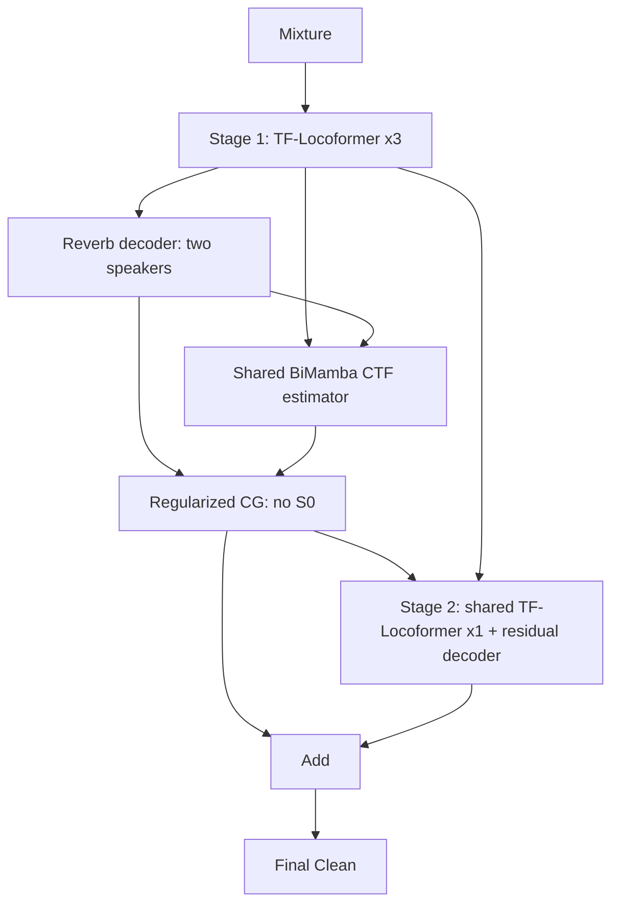

# Joint CTF dereverberation: 3 front-end blocks + 1 restoration block

This is the revised architecture agreed after the initial design. Stage 1 and
Stage 2 name network parts; both are trained together from scratch. The earlier
S0 decoder and sequential pretraining/fine-tuning schedule have been removed.
Old `train_ctf_stage*.yaml` configurations/checkpoints are incompatible with this
revision; use the earlier Git commit to reproduce that architecture.



## Architecture

- Front end: 3 ordinary TF-Locoformer-S blocks, D=96, attention projection 128,
  4 heads, RMSGroupNorm, frequency then time, Macaron ConvSwiGLU widths128/128,
  kernel8. Its sole pre-CG RI decoder predicts both speakers' Reverb spectra.
- CTF estimator: backbone features + the target speaker's predicted Reverb,
  98-to-64 projection, time BiMamba, frequency BiMamba, attentive time pooling,
  frequency BiMamba, Linear64-to-256. Three BiMamba blocks, two independent
  official Mamba-1 directions per block; all speaker parameters are shared.
- CG: solve `min_s ||A(H)s-Y_hat||_W^2 + lambda_f ||s||^2`, with
  `lambda_f = gamma * sum_l |H(f,l)|^2 + eps`. Start from zero; no S0 signal,
  pretrained Clean estimator or Clean decoder before CG. Default taps128,
  gamma0.1, eps1e-6, 8 unrolled complex64 iterations. FFTs implement causal
  linear convolution and its exact complex adjoint, not circular division.
- Restoration: concatenate backbone Z96 and RI(CG output)2; project98-to-96,
  apply one TF-Locoformer block and a 96-to-2 RI residual decoder. Add its
  complex residual to the CG output. This one block/decoder is shared between
  speakers (two speakers still incur two passes' computation). The output
  layer is zero-initialized, so the initial final output equals the CG output.

The supplied joint/no-CG configurations each contain 5,380,359 parameters;
the four-block baseline contains 5,125,252. The proposal adds approximately 5.0%
relative to the baseline. Four distinct TF-Locoformer blocks therefore
do not imply the same total parameter count or computation as the baseline.

Inference is mixture-only. It returns `reverb`, `ctf`, `clean_deconv` and
`clean_final`, valid lengths, the common scale and decoded waveforms. There is
no `clean_prior`. Native complex spectra are [B,N,F,T], CTFs [B,N,F,L].

## Losses and training

`L = L_clean + L_reverb + L_ctf`, with all three initial weights1.

Clean and Reverb use the original baseline's actual `SISNRLoss` plus PIT:
zero-mean waveform SI-SNR, `eps=1e-7` (approximately70dB clamp). The configured
SI-SNR PIT criterion is consumed by this model, not silently ignored. There
are no RI/magnitude losses on predicted Clean or predicted Reverb. Select PIT
once using final Clean; reuse that assignment for Reverb and CTF supervision.

CTF supervision remains RI-L1 + magnitude-L1 on `H_hat * true_Direct` versus
`true_Reverb`, using linear STFTs and the same speaker assignment. It never
uses predicted Reverb as its only target. All teachers share mixture-derived
normalization. Component losses and gradient norms (every100 updates) are
recorded. SI-SNR does not constrain output gain; scale-dependent SNR remains
an evaluation diagnostic, and these losses do not guarantee matched branch gain.

| phase | Configuration |
|---|---|
| `joint` | 3+1 blocks, CTF estimator and CG; all trained from scratch |
| `joint_nocg` | Same parameters/losses; predicted Reverb bypasses CG into restoration |
| `b1` | Ordinary 4-block baseline, same SI-SNR loss and revised data/context handling |

All use seed0, Xavier (preserving Mamba initialization and zero residual head),
FP32, batch4, AdamW lr0.001/eps1e-8/weight_decay0.01, gradient clip5,
warmup4000, plateau factor0.5/patience3, max150 epochs and early-stop patience10.
LR scheduling and early stopping monitor the common `valid.loss_clean`;
checkpoints are selected by `valid.si_snr`, with 5-best averaging at training
end. Unlike the previous configs, auxiliary losses do not select the checkpoint
or control LR. Independent early stopping does not ensure equal update counts;
match update budgets for a strict CG versus no-CG comparison and record them.

`b1` matches the proposal's context and valid-length normalization, not the old
baseline's arbitrary-sample 4-second crops/padded-batch normalization. Thus it
controls these implementation differences too. A historical noisy WHAMR B0
exists at `../enh7_baseline`; its saved RESULTS report test SI-SNR11.46dB,
not SI-SNR improvement. Re-evaluate B0 with the same scoring/export convention
before comparing. Its generated5-best average was verified, but which weight
file its historical evaluation actually used remains unconfirmed.

## Data and context

Noisy WHAMR `mix_both_reverb_min_8k`, 20k/5k/3k train/valid/test, left microphone,
Direct speech teachers. Existing paired data are in the original checkout's
`egs2/whamr/enh_rir/dump_ctf_joint`. Pass its absolute path from this worktree.
The paired manifest/indexes preserve the baseline mixture and Direct files,
original speaker ordering and shape statistics; Reverb references original FLOAT
WAVs. Baseline mixture/Direct are PCM16. Recorded source clipping counts
2650/1350/646 aggregate mixture and Direct files, not Direct alone.

Original dataset-local `enh1/data/whamr/whamr_scripts/wham_room.py` uses
`max_order=0` for Direct, preserving propagation delay. Its paired generator
applies the same per-speaker gain to Direct/Reverb. An effective Direct-to-Reverb
CTF is not simply the original source-to-microphone RIR's STFT.

Train losses use a 32000-sample target, plus real past8384/future256 samples
when available (maximum40640 input samples =5.08s); starts are hop-aligned.
Validation uses full utterances. CTF losses and CG observation masks exclude
missing-history/artificial-boundary observations, while retaining genuine
preceding input context. iSTFT precedes waveform target cropping.

STFT/iSTFT: actual8kHz, FFT/window256, hop64, periodic Hann, center/reflect,
normalizedfalse, onesidedtrue, no spectral compression, explicit output lengths.
Each utterance is encoded at its true boundary and every teacher uses its
mixture's common scale. Padding never enters normalization or losses.

`local/check_paired_dump.py` verifies existing manifest hashes, split IDs,
aligned shapes, fold limits and one WAV existence per index. It relies on the
full original adapter's waveform audit. Audio paths are host-specific; prepare
paired indexes on TSUBAME rather than copying midgar's absolute paths.

## Commands

Activate an existing compatible ESPnet + official `mamba_ssm` environment and
an appropriate allocation. The launcher itself never submits scheduler jobs.
From this recipe:

```bash
bash run.sh --phase joint --dry_run true --paired_dump /absolute/verified/dump_ctf_joint
bash run.sh --phase joint --paired_dump /absolute/verified/dump_ctf_joint
bash run.sh --phase joint_nocg --paired_dump /absolute/verified/dump_ctf_joint
bash run.sh --phase b1 --paired_dump /absolute/verified/dump_ctf_joint
bash run.sh --phase joint --resume true --paired_dump /absolute/verified/dump_ctf_joint

# Only when a new host-specific paired dump is needed; refuses existing output.
bash run.sh --stage 1 --stop_stage 1 --paired_dump dump_paired \
    --baseline_root ../enh1 --source_data_root ../enh1/data

python -m espnet2.bin.ctf_dereverb_inference \
    --train_config exp/enh_train_ctf_joint_whamr_8k_1gpu_batch4/config.yaml \
    --model_file exp/enh_train_ctf_joint_whamr_8k_1gpu_batch4/valid.si_snr.ave_5best.pth \
    --wav_scp /absolute/verified/dump_ctf_joint/raw/cv_mix_both_reverb_min_8k/wav.scp \
    --ref1_scp /absolute/verified/dump_ctf_joint/raw/cv_mix_both_reverb_min_8k/spk1.scp \
    --ref2_scp /absolute/verified/dump_ctf_joint/raw/cv_mix_both_reverb_min_8k/spk2.scp \
    --output_dir exp/joint_valid --device cuda --write_reverb true
```

Export saves CG-before-restoration and final Clean separately, optionally Reverb,
FLOAT WAVs at original amplitude, complex CTF NPYs and summary JSON. It reads
mono or the left channel of stereo actual8kHz audio. References only score
predictions, using one final-Clean assignment for all branches. Supplied Direct
references also score an exported Reverb branch against Direct; that is not
Reverb-to-Reverb separation performance. Training's `si_snr_reverb` diagnostic
uses the paired Reverb teachers. STOI is optional.
Use validation only to select gamma/iterations; do not reuse an output directory.
For no-CG, `clean_deconv` denotes the bypassed Reverb input, not actual inversion.

Run new and existing regression checks from the repository root with an owned
`TMPDIR` and numerical caches (the official CPU reference scan is slow):

```bash
python -m unittest \
    test.espnet2.enh.layers.test_ctf_deconvolution \
    test.espnet2.enh.layers.test_speaker_ctf_estimator \
    test.espnet2.enh.test_ctf_dereverb \
    test.espnet2.enh.test_ctf_dereverb_inference \
    test.espnet2.enh.test_ctf_joint
```

## TSUBAME launch

Use an isolated checkout at the synchronized commit. Existing paired data can
be reused at
`/gs/bs/tga-shinoda/nitsu/research/tf-locoformer/espnet/egs2/whamr/enh_rir/dump_ctf_joint`.
From this recipe, create `qsub_logs`, then submit a charged CUDA readiness job:

```bash
qsub -g tga-shinoda qsub/check_joint_cuda.sh /absolute/verified/dump_ctf_joint
# After it passes, supply its actual report path:
qsub -g tga-shinoda qsub/train_joint_1gpu.sh /absolute/verified/dump_ctf_joint \
    exp/cuda_checks/check_JOB_ID.json
```

The readiness job requests `gpu_1=1`, priority -5, 20 minutes. It checks Mamba
CUDA/reference forward and input gradients, four full-context 40640-sample
examples, four AdamW updates with finite gradients, and full-length validation
of the longest validation utterance. The report records time and memory; no
probe weights are used for production training. This is a charged job, not a
free-trial measurement.

The base `tf-locoformer` conda environment does not itself contain Mamba.
Both jobs add the existing user-owned dependency directory
`/gs/bs/tga-shinoda/nitsu/research/tf-locoformer/espnet/egs2/whamr/damsep_clean/.deps/mamba-cu118-torch21-py310`
to PYTHONPATH, read-only. It contains Mamba1.2.0.post1 and causal-conv1d1.2.0.post2, matching
PyTorch2.1/CUDA11.8/Python3.10. `CTF_MAMBA_DEPS` can select another compatible
isolated directory. The shared conda environment is never installed into or
modified by these jobs; the CUDA report records dependency versions.

Training requests `gpu_1=1` (8 cores, 96 GB host RAM, one full GPU), priority -5,
24 hours. It verifies a passed readiness report with exactly matching source
commit, configuration and paired manifest, and starts from scratch or resumes
the same experiment's checkpoint. Further submissions resume completed epochs;
an interrupted epoch repeats. Scripts preserve scheduler GPU visibility, use
owned task-specific `/tmp/nitsu` directories, and keep caches in the recipe.

Using the official coefficients checked on 2026-10-27, upper point estimates
are `0.2 * 0.8 * (20/60) = 0.0533` for readiness and
`0.2 * 0.8 * 24 = 3.84` for one training allocation. Actual duration is not
known before the GPU check; these are estimates, not confirmed charges.

The revised implementation passed 45 unit/integration/regression tests. A tiny
synthetic CPU trainer also completed joint training, saved its optimizer and
best SI-SNR checkpoint, and resumed for another epoch (optimizer steps 1 to 2).
This verifies training integration, not trained speech quality.

Production GPU training/performance, CUDA memory/throughput, physical-RIR and
independent-probe reference-CTF audits remain unverified. The earlier S0-model
smoke results do not validate this revision. Establish real Direct-to-Reverb CTF
approximation error before production training and use matched no-CG controls
before claiming a benefit. No Sweep supervision or pretrained external network
is included.
